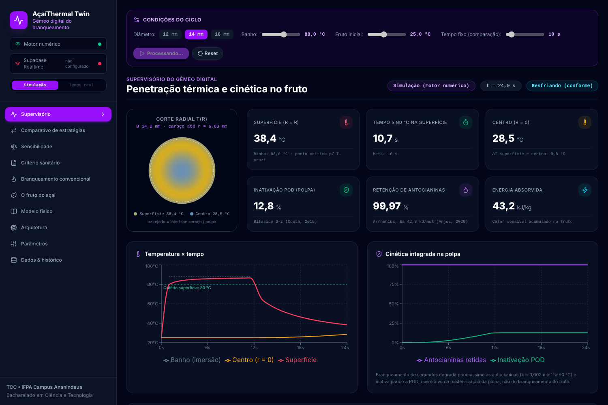

# AçaíThermal Twin 🍇⚡

> **Gêmeo digital do branqueamento de frutos de açaí (*Euterpe oleracea*): condução transiente em esfera composta, cinética integrada e corte térmico preditivo**
> *Trabalho de Conclusão de Curso — Bacharelado em Ciência e Tecnologia — IFPA Campus Ananindeua*

[](LICENSE)
[](https://python.org)
[](https://fastapi.tiangolo.com)
[](https://react.dev)
[](https://supabase.com)

---

## 📌 Problema

O branqueamento (água a **80 °C por 10 s**, exigido no Pará desde 2012 e no Amapá desde 2015) é a barreira contra a transmissão oral da Doença de Chagas pelo açaí. O *Trypanosoma cruzi* chega ao fruto em fezes e fragmentos de barbeiro **aderidos à casca**. Logo, o que importa é a **temperatura efetiva da superfície do fruto**, não a da água.

A Embrapa mediu que, com a água a ~80 °C, a superfície do fruto fica em 77,8–78,8 °C nos primeiros 10 s. O binômio nominal sozinho não garante a condição no fruto.

O AçaíThermal Twin estima em tempo real o campo de temperatura dentro do fruto a partir da leitura do banho. Ele acompanha quanto tempo a superfície passou acima de 80 °C e avisa o momento exato de retirar os frutos (**corte preditivo**), com a menor carga térmica possível.

## 🔬 Modelo

### Condução transiente em esfera composta (caroço + polpa)

$$\rho c\,\frac{\partial T}{\partial t} = \frac{1}{r^2}\frac{\partial}{\partial r}\left(k\,r^2\frac{\partial T}{\partial r}\right),\qquad
\left.\frac{\partial T}{\partial r}\right|_{0}=0,\qquad
-k\left.\frac{\partial T}{\partial r}\right|_{R}=h\,(T_R-T_\infty)$$

* O caroço ocupa ~85 % do volume, e a polpa é uma casca fina com propriedades próprias.
* A discretização usa **volumes finitos** (conservativos), com condutância harmônica na interface. O passo explícito é subdividido automaticamente para respeitar a estabilidade.
* O contorno é **convectivo** (Robin). O coeficiente *h* ≈ 4700 W/m²K foi calibrado contra as medições da Embrapa (RMSE 0,5 °C, script `engine/scripts/calibrar_h.py`).

### Cinética integrada nó a nó (só na polpa, ponderada pela massa)

| Grandeza | Modelo | Parâmetros | Fonte |
|---|---|---|---|
| Antocianinas | 1ª ordem, Arrhenius | $E_a$ = 42,8 kJ/mol, $k_0$ = 36,6 s⁻¹ | Anjos et al. (2020) |
| Peroxidase (POD) | bifásico, D–z | $D_{89}$ = 7,10 s / z = 4,3 °C; $D_{89}$ = 254 s / z = 2,4 °C | Costa (2019), UFU |
| Critério sanitário | superfície ≥ 80 °C acumulada | ≥ 10 s | legislação PA (2012) / AP (2015) |

## ⚖️ Resultados do modelo (fruto de 14 mm, banho a 88 °C, fruto a 25 °C)

| Estratégia | Imersão | Superfície ≥ 80 °C | Energia absorvida | POD inativada | Antocianinas | Critério |
|---|---:|---:|---:|---:|---:|:---:|
| **Preditiva (gêmeo digital)** | **11,5 s** | 10,7 s | **77,7 kJ/kg** | 12,8 % | 99,97 % | ✅ |
| Tempo fixo 10 s | 10,0 s | 9,2 s | 73,8 kJ/kg | 9,6 % | 99,97 % | ❌ |
| Centro ≥ 70 °C (versão anterior) | 83,0 s | 82,3 s | 138,8 kJ/kg | 81,8 % | 99,80 % | ✅ |

Principais conclusões:
1. Com o critério na superfície, o tempo de corte **quase não depende do tamanho do fruto**: no mesmo banho a 88 °C, fica entre 11 e 11,5 s para frutos de 12 a 16 mm. Com o critério no centro, cresce com R² (61,5 s → 108,5 s).
2. Retirar no momento certo reduz em **~44 %** o calor absorvido em relação a esperar o centro chegar a 70 °C.
3. **Água a 80 °C não cumpre o critério**: a superfície só tende assintoticamente a 80 °C.
4. Em segundos de branqueamento, a perda de antocianinas é desprezível (< 0,1 %), e a POD é pouco inativada. A POD é indicador da *pasteurização da polpa*, não do branqueamento.

## 🏗️ Arquitetura

```
Sensor do banho (ESP32 · simulator/mock_sensor.py)
      │  POST /api/v1/lotes/{id}/leituras   (T_banho a cada 1 s)
      ▼
Motor numérico — engine/ (FastAPI + NumPy)
      ├─ avança T(r,t) e a cinética do lote
      ├─ prevê o tempo até cumprir o critério → MANTER / RETIRAR_DO_BANHO
      └─ grava no Supabase (chave service_role)
      ▼
Supabase — Postgres + Realtime (RLS: leitura pública, escrita só do motor)
      ▼
Painel — frontend/ (React + Recharts)
      ├─ modo Tempo real: assina estado_digital_twin
      └─ modo Simulação: POST /api/v1/comparar e reproduz a série
```

```
engine/
  acai_twin/parametros.py   parâmetros com fontes (hipóteses marcadas)
  acai_twin/termico.py      volumes finitos em esfera composta
  acai_twin/cinetica.py     Arrhenius e D–z integrados no tempo
  acai_twin/processo.py     lote, corte preditivo, simulação completa
  main.py                   API REST
  tests/                    verificação contra solução analítica, conservação, API
  scripts/calibrar_h.py     calibração do coeficiente convectivo
frontend/src/               painel (abas em src/abas/, laudo PDF em laudo.js)
simulator/mock_sensor.py    sensor virtual que obedece ao corte preditivo
supabase/schema.sql         tabelas, migração, RLS e Realtime
```

## 🚀 Como rodar

```bash
# 1. Motor
cd engine
pip install -r requirements-dev.txt
pytest                       # 16 testes
uvicorn main:app --reload    # http://127.0.0.1:8000/docs

# 2. Painel (outro terminal)
cd frontend
cp .env.example .env.local   # ajuste VITE_ENGINE_URL (e Supabase, se usar)
npm install && npm run dev   # http://localhost:5173

# 3. Sensor virtual (opcional, modo tempo real)
python simulator/mock_sensor.py --banho 88
```

Para persistência, rode `supabase/schema.sql` no SQL Editor do Supabase e defina `SUPABASE_URL` e `SUPABASE_SERVICE_KEY` no ambiente do motor (veja `engine/.env.example`). O painel usa somente a chave *anon*, que o RLS limita a leitura.

## ✅ Verificação

* Centro da esfera homogênea comparado à solução analítica em série (Bi de 2,6 a 61): erro < 0,5 °C.
* Conservação de energia e princípio do máximo.
* $k(T)$ das antocianinas reproduz os valores experimentais de Anjos et al. (2020).
* A previsão de corte em tempo real coincide com a simulação completa.

## ⚠️ Limitações e hipóteses (a tratar no TCC)

* Propriedades termofísicas do **caroço** estimadas (sem medição publicada para o açaí). Calibrar com termopar no centro.
* **Fração lábil da POD** (0,80) assumida. Conferir no texto completo de Costa (2019).
* Fruto isolado e esférico, sem efeito de carga do tanque nem queda da temperatura do banho ao imergir o lote.
* O critério 80 °C/10 s é regulatório. Não há modelo de inativação térmica do *T. cruzi* implementado.
* Conferir número e texto das normas estaduais antes de citá-las no trabalho.

## 📚 Referências

* Anjos, C. A. R. et al. (2020). Thermal degradation kinetics of total anthocyanins in açaí pulp and transient processing simulations. *SN Applied Sciences* 2:523. doi:10.1007/s42452-020-2340-0
* Costa, H. C. B. (2019). *Avaliação da pasteurização contínua da polpa de açaí sobre a inativação térmica das enzimas peroxidase e polifenoloxidase.* Dissertação, UFU.
* Bezerra, V. S. et al. Temperatura efetiva na superfície de frutos de açaí no branqueamento. Embrapa (Alice, doc. 1070158).
* Bezerra, V. S. (2017). Tratamento térmico do açaí. Embrapa Amapá, Comunicado Técnico 151.
* Ferreira, E. A. P. et al. (2016). O branqueamento do açaí em batedeiras artesanais para controle do *T. cruzi*. Embrapa.
* Caracterização termofísica da polpa de açaí. UFCG (BDTD riufcg/2218).

---
Licença MIT.
