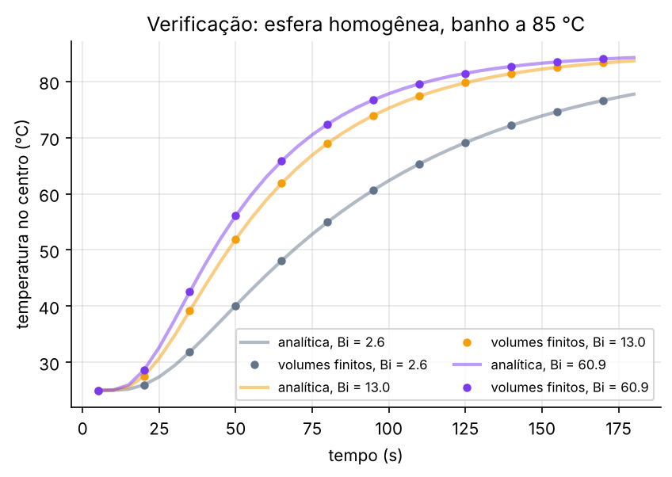
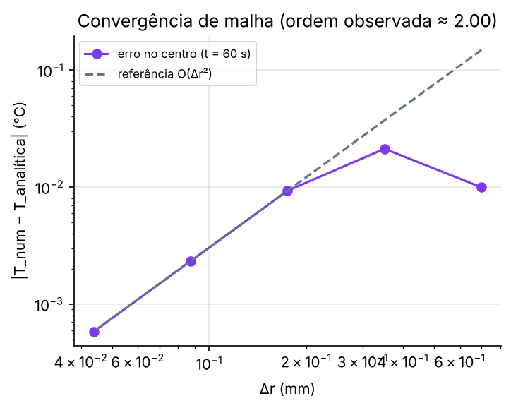
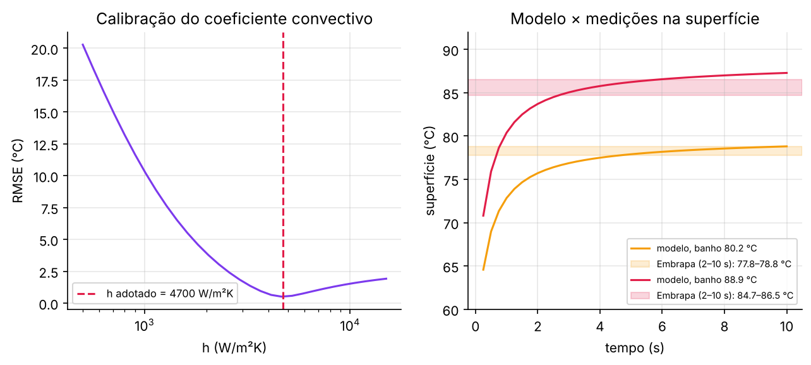
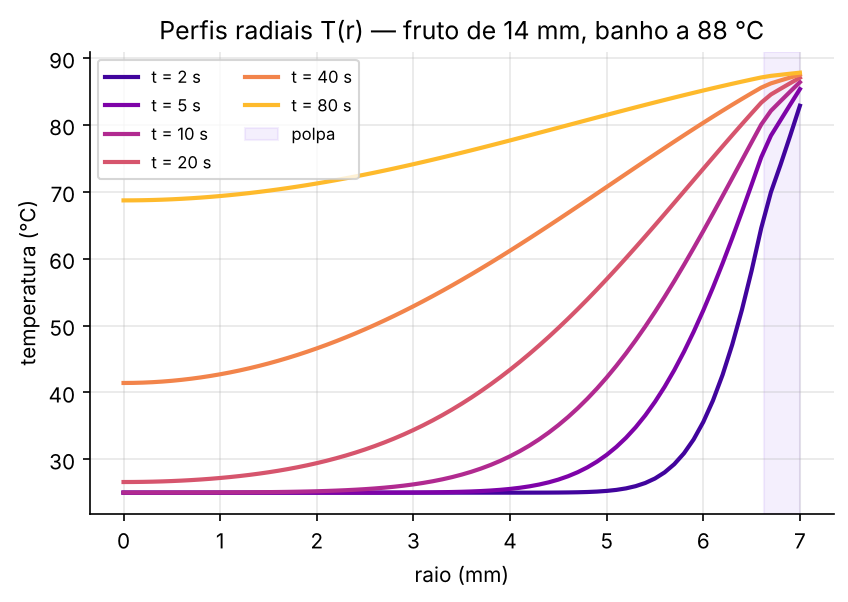
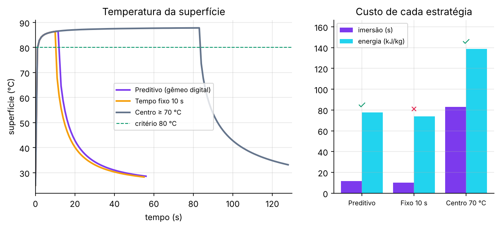
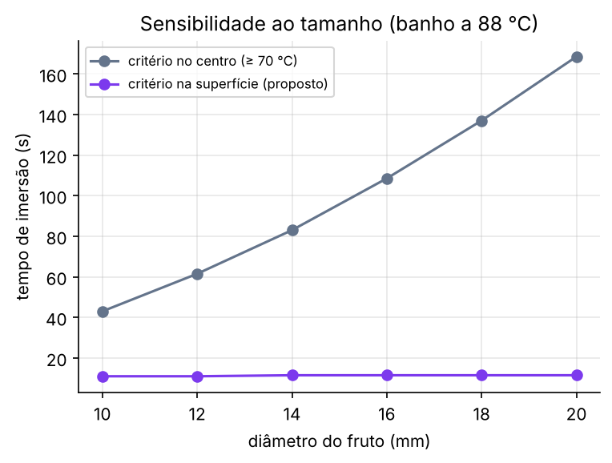

# Verificação, calibração e resultados

Todas as figuras e números desta página são gerados por

```bash
cd engine && python -m scripts.gerar_figuras      # ou: make figuras
```

O script grava as imagens em `docs/figuras/` e os valores em [`docs/figuras/resumo.json`](figuras/resumo.json). Rode-o de novo sempre que mudar um parâmetro, para manter texto e figuras consistentes.

## 1. Verificação contra a solução analítica

Para uma esfera **homogênea** com convecção na superfície existe solução em série:

$$
\frac{T(r,t)-T_\infty}{T_0-T_\infty} = \sum_{n} C_n\, e^{-\lambda_n^2 \alpha t/R^2}\,\frac{\sin(\lambda_n r/R)}{\lambda_n r/R},
\qquad 1-\lambda_n\cot\lambda_n = \text{Bi}
$$

implementada em [`acai_twin/analitico.py`](../engine/acai_twin/analitico.py). O solver de volumes finitos (81 nós) reproduz a temperatura do centro com erro máximo de **0,005 °C** em 180 s, para Bi de 2,6 a 61.



| Bi | erro máximo no centro (°C) |
|---:|---:|
| 2,6 | 0,001 |
| 13,0 | 0,003 |
| 60,9 | 0,005 |

## 2. Convergência de malha

Com o refino de Δr, o erro cai com **ordem 2,0**, como esperado para o esquema centrado em volumes finitos.



| nós | Δr (mm) | erro no centro, t = 60 s (°C) |
|---:|---:|---:|
| 21 | 0,350 | 0,021 |
| 41 | 0,175 | 0,0093 |
| 81 | 0,0875 | 0,0023 |
| 161 | 0,0438 | 0,0006 |

O modelo usa 71 nós por padrão (Δr = 0,1 mm), o que coloca ~4 nós na camada de polpa.

## 3. Conservação de energia e princípio do máximo

Testes automatizados (`engine/tests/test_termico.py`):

- o calor que entra pela superfície, somado em cada subpasso, é igual à variação de energia interna do fruto (tolerância relativa de 10⁻¹⁰), em aquecimento e em resfriamento;
- nenhuma temperatura sai do intervalo [T₀, T∞] durante o aquecimento.

## 4. Calibração do coeficiente convectivo

O coeficiente h é o único parâmetro ajustado. O ajuste usa medições de temperatura na superfície de frutos imersos (Bezerra et al., Embrapa):

| Banho | Superfície medida (2–10 s) | Modelo (média 2–10 s) |
|---:|---:|---:|
| 80,2 °C | 77,8–78,8 °C | 77,8 °C |
| 88,9 °C | 84,7–86,5 °C | 86,1 °C |

Resultado: **h ≈ 4700 W/m²K**, com RMSE de 0,51 °C.



## 5. Perfis radiais



A polpa (faixa sombreada) aquece em segundos. O centro do caroço leva mais de um minuto. Por isso um critério no centro (r = 0) é muito mais custoso que um critério na superfície.

## 6. Estratégias de corte (fruto de 14 mm, banho a 88 °C)



| Estratégia | Imersão (s) | Energia absorvida (kJ/kg) | Critério sanitário |
|---|---:|---:|:---:|
| Preditiva (gêmeo digital) | 11,5 | 77,7 | ✅ |
| Tempo fixo de 10 s | 10,0 | 73,8 | ❌ |
| Centro ≥ 70 °C (versão anterior do projeto) | 83,0 | 138,8 | ✅ |

## 7. Sensibilidade ao diâmetro



| Diâmetro (mm) | Preditivo (s) | Centro ≥ 70 °C (s) |
|---:|---:|---:|
| 10 | 11,0 | 43,0 |
| 12 | 11,0 | 61,5 |
| 14 | 11,5 | 83,0 |
| 16 | 11,5 | 108,5 |
| 18 | 11,5 | 137,0 |
| 20 | 11,5 | 168,5 |

Com o critério na superfície, o tamanho do fruto praticamente não importa. Com o critério no centro, o tempo cresce aproximadamente com R².
